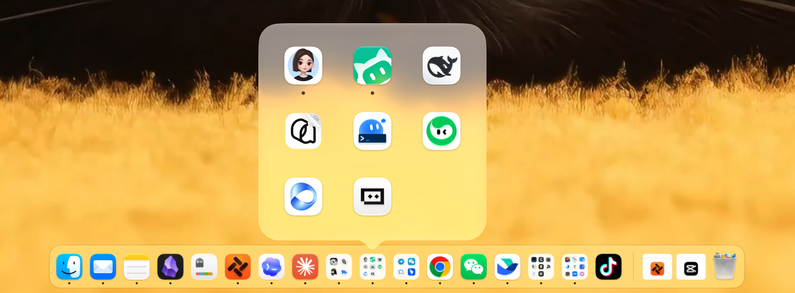
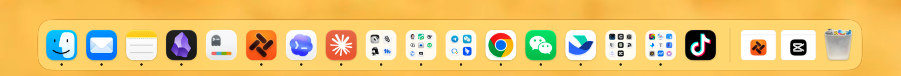

# DockFolders

**iPhone-style app folders for the Mac Dock.**



[中文](README.md)

The interface is in Chinese; quoted labels below are translations.

## Why

The macOS Dock can't group apps into folders. As you install more apps, the Dock either keeps growing and its icons keep shrinking, or you take apps out of it and dig through Launchpad whenever you need them.

DockFolders replaces the Dock with a bar that looks and feels as close to the system Dock as possible, and adds iPhone-style folders: put apps of one kind into a single slot, so one spot holds several apps, one click away.

## A look at the bar



Pinned apps and folders sit on the left; each folder icon shows thumbnails of its apps. A dot under an icon means the app is running. The Trash is on the far right. Icon size, spacing and the floating glass backdrop are calibrated against the system Dock.

## Features

### iPhone-style folders

- **Create**: drag an app onto the center of another app. The target grows a folder backdrop and shows “Release to create a group”; release and the folder is made. Dropping near an icon's edge reorders instead.
- **Open**: click a folder and a panel unfolds above it, three apps per row. Click an app to open or switch to it; an app that isn't running yet bounces in the panel, and the panel closes once it launches.
- **Close**: press Esc, click outside the panel, or click the folder again.
- **Organize**: drag to reorder inside the panel; drag an app out of the panel back onto the bar; right-click a folder to rename or ungroup it.
- **No duplicates**: when an app inside a folder is running, the folder shows a running dot instead of adding another icon to the bar.

### Works like the system Dock

- Magnification on hover (follows your system Dock's magnification setting), running indicators, launch bounce, unread badges.
- Right-click an app: Open / Switch, Show in Finder, Keep in bar or Remove, Hide, Quit, Force Quit.
- Drag icons to reorder; drag one off the bar and release when it says “Release to remove from the bar” to remove it.
- Drop files or folders on an empty part of the bar to add them on the right; click a folder to expand it.
- Minimized windows appear on the right.
- The Trash shows whether it's empty or full; right-click to open it or empty it (a confirmation dialog appears first).

### Windows stay clear of the bar

Once the system Dock is hidden, apps that are already running assume there's no Dock at the bottom and stretch their windows all the way down. DockFolders shortens filled, tiled or overlapping windows so they end above the bar, and moves small floating bars (such as a voice-input bar) out of the way. Double-clicking a title bar to zoom still toggles between the original size and filled.

### Displays and settings

Right-click an empty part of the bar, or click the four-squares icon in the menu bar, to:

- Manage folders, undo layout changes
- Position: bottom, left, right
- Display: main display, a specific display, all displays, or follow the pointer
- Auto-hide, icon size
- Show recent apps: turn it off and unpinned apps disappear from the bar when they quit

## Getting started

### 1. Build

Requires Apple Silicon, macOS 14 or later, Xcode command line tools (Swift 6) and Python 3.

```bash
git clone https://github.com/DaliangPro/DockFolders.git
cd DockFolders
bash build.sh
```

To run the tests first:

```bash
swift test -c release --scratch-path build/tests --cache-path build/package-cache
```

### 2. Open

```bash
open build/DockFolders.app
```

The system Dock hides itself, the bar appears at the bottom of the screen, and the apps pinned in your Dock come along.

### 3. Grant permissions

In System Settings › Privacy & Security:

| Permission | Used for |
| --- | --- |
| Accessibility | Keeping windows clear of the bar, moving floating bars, menus |
| Screen Recording | Only optional features such as the shadow Dock |
| Automation › Finder | Emptying the Trash; asked the first time you use it |

### 4. Quit

Click the four-squares icon in the menu bar, or right-click an empty part of the bar, and choose Quit (退出). The system Dock is restored on quit.

## FAQ

**Where did the system Dock go?**
It's set to auto-hide and moved to the display the bar is on, so minimized windows still shrink toward the bottom of the screen. It's restored when you quit DockFolders.

**The app hung or crashed. How do I get my Dock back?**
Double-click `RestoreDock.command` in the project folder. It doesn't need the app's UI or Accessibility permission, and restores the system Dock settings and the reserved screen area.

**Why did my window get shorter on its own?**
That's DockFolders keeping windows clear of the bar: a window that reaches under the bar has its bottom edge moved above it. A newly opened app may fill the screen first and then get shortened.

**An unpinned app stays on the bar after quitting.**
That's “recent apps”. Right-click an empty part of the bar and untick “Show recent apps” (显示最近使用的 App).

**Where are my folders and settings stored?**
In `Data/` inside the project folder: folders, pinned order and preferences. Nothing is uploaded. Keep the project folder and don't move the app bundle out of it.

**Is there another mode?**
Yes, the “shadow Dock”: the system Dock stays visible, reserving screen space and receiving minimized windows, with the bar drawn on top of it. It needs Screen Recording permission to paint the backdrop under the bar.

```bash
defaults write io.daliang.dockfolders useShadowDock -bool true
```

Restart the app for it to take effect.

## Caveats

- The app changes system Dock settings (auto-hide, icon size, pinned items and so on). It records the original values first and restores them on quit, so please quit it normally.
- Two recovery helpers run alongside the app and quit with it. No login items or background services are installed.
- Private interfaces it uses include the Dock's reserved screen area (SkyLight), CoreDock, and Accessibility window numbers. A macOS update may break them.

## Known limitations

- Only one display can have a system-reserved area; in “all displays” mode the others rely on window adjustment.
- Apps that are already running can't see the bar's reserved space, so their windows are corrected after the fact and may briefly overlap the bar.
- App-specific Dock menu items aren't supported yet, and some custom Dock tiles and full-screen / Spaces combinations aren't fully covered.

## License

[MIT](LICENSE)
