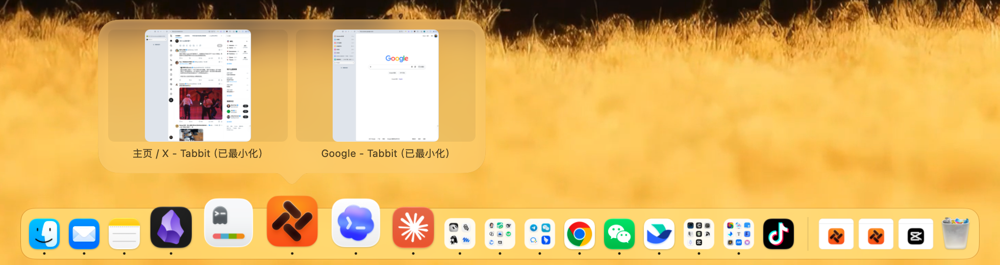

# DockApex

**App 再多，一个 Dock 也装得下。**


[English](README.en.md)

DockApex 是一条替代 macOS 系统 Dock 的应用栏：外观、尺寸和手感按系统 Dock 校准，再加上 iPhone 那样的 App 分组。同一类 App 收进一个格子，一个位置放下好几个 App，点开就能用。

## 为什么做它

macOS 的 Dock 不能把 App 收进文件夹。装的 App 一多，要么 Dock 越拉越长、图标越缩越小，要么只好把不常用的 App 移出去，用的时候再去启动台里翻。DockApex 想让 Dock 既装得下，又保持原来的样子和用法。

## 看看它的样子


应用栏分成三段，中间有分隔线：左段是固定的 App 和分组，分组图标里显示组内 App 的缩略图；中段是没固定但正在运行的 App 和最近使用的 App；右段是最小化的窗口、文件和文件夹入口，以及废纸篓。图标下方的小点表示正在运行。图标尺寸、间距和悬浮的玻璃底板都按系统 Dock 校准，图标多了会自动缩小。

## 功能

### iPhone 式分组

- **建组**：把一个 App 拖到另一个 App 图标的正中央并放慢（拖得太快不算），目标图标会长出文件夹底板并提示“松开创建分组”，松手就建好了，面板随即展开。新分组叫“新分组”。拖到图标边缘则是调整顺序。
- **加入**：把 App 拖到分组图标中央，提示“松开加入分组”。分组面板展开时，也可以把栏上的 App 直接拖进面板，插到想要的位置。从访达拖 .app 过来同样可以建组或加入。把一个分组拖到另一个分组上，两个分组会合并，保留目标分组的名字。一个 App 只会在一个分组里。
- **打开**：单击分组，面板从图标外侧展开（栏在底部时在上方，在左右侧时在旁边），带一个指向分组图标的小箭头，每行 3 个 App，放不下时可以滚动。单击已运行的 App 会切过去并收起面板；还没运行的 App 会在面板里跳动，启动后（或跳满 3 下）面板收起。
- **收起**：按 Esc、点面板外面、再点一次分组图标，或者切到别的 App。
- **整理**：在面板里拖动排序。把 App 拖出面板：放到栏上的空隙，就移出分组并固定在那里；放到另一个 App 中央，就和它新建分组；放到栏外则弹回原位。成员右键菜单里的“移除分组”，是把这个 App 移出分组、放回栏上。
- **右键分组**：展开分组；“编辑 / 重命名分组…”会打开管理窗口去改；“解散分组”会把成员按原顺序放回分组原来的位置。
- **移除分组**：把分组图标拖出应用栏会先弹出确认，确认后分组和组内 App 都从栏上移除（App 本身不会被卸载，可以用“撤销布局更改”恢复）。
- **管理分组**：在设置里打开“管理分组”窗口，可以给分组添加 App（点“添加应用…”或从访达拖 .app 进列表）、移出 App、调整顺序、改名、解散（会先确认）。找不到的 App 会标出“原应用已移动或不存在”。新建分组要在应用栏上拖叠。
- **不重复占位**：分组里的 App 运行时，分组图标下方会出现运行指示，不会在栏上再多出一个图标。分组图标上的角标是组内各 App 未读数的总和。

### 外观与反馈

- 悬停放大、名称提示、运行指示、启动时跳动、未读角标，都和系统 Dock 一样。
- 按下图标时照原生 Dock 变暗；App 暂时找不到时，图标上显示原生 Dock 的灰色问号。
- App 用自带的 Dock 图标插件画图标时（比如在 App 里换过图标），应用栏显示的也是它画的那个。
- 放大（及放大后的大小）、运行指示、启动动画，以及是否把窗口最小化到应用程序图标，都跟系统设置“桌面与程序坞”里的选项走：在系统设置里改，应用栏随之变化（用影子 Dock 时除外）。DockApex 的菜单里没有另设开关。

### 点按与菜单

- **单击 App**：没运行就打开，已运行就切过去；如果它的窗口全都最小化了，会还原其中一个。
- **修饰键单击**：⌘ 单击在 Finder 中显示（文件和文件夹入口也一样）；⌥ 单击当前在用的 App 会隐藏它，⌥ 单击别的 App 会切过去并隐藏原来的；⌘⌥ 单击会切过去并隐藏其他所有 App。
- **呼出菜单**：右键、Control 点按，或按住约半秒。按住不放、拖到菜单项上再松开，就能直接选中。
- **App 的右键菜单**：打开／切换、它当前的窗口（◆ 表示已最小化，✓ 表示当前窗口）、App 自带的 Dock 菜单项（比如访达的“新建‘访达’窗口”）、“选项”、“显示所有窗口”、在 Finder 中显示、保留在应用栏或从应用栏移除、隐藏、退出、强制退出（会先确认）。访达固定在最前，不能移除或退出。

### 窗口预览



指针在运行中的 App 上停一下，就会弹出它的窗口缩略图，最小化的窗口也显示真实画面。点缩略图切到对应窗口（最小化的会先还原），点 × 关闭窗口。应用栏和分组面板里都能用。

### 拖放

- **调整顺序与移除**：拖动图标调整顺序；把图标拖出应用栏，看到“松开移出应用栏”时松手即可移除。拖动途中按 Esc 取消。
- **从访达拖 App**：把 .app 拖到栏上的空隙会固定在那里，拖到图标中央会建组或加入分组。
- **文件和文件夹入口**：把文件或文件夹拖到应用栏空白处，会变成右段的入口。
- **用 App 打开文件**：把文件拖到 App 图标上（包括分组面板里的 App），就用这个 App 打开。
- **放进文件夹**：把文件拖到文件夹入口上，同一块磁盘默认移动，跨磁盘（U 盘、网络盘等）默认拷贝；按住 ⌥ 一律拷贝，按住 ⌘ 一律移动。
- **扔进废纸篓**：把文件拖到废纸篓上，就移到废纸篓。

### 文件、文件夹、最小化窗口与废纸篓

- **文件夹入口**：单击展开内容列表，默认按修改时间排序，可以切换为按名称，最多列 500 项。单击某一项打开它；右键可以打开、在 Finder 中显示、拷贝、移到废纸篓；也可以把某一项拖出去；底部的“在 Finder 中打开”会打开这个文件夹。文件入口单击直接打开。
- **最小化的窗口**：每个最小化的窗口在右段占一格，图标是装着 App 图标的窗口框。单击还原并切过去；右键有“显示窗口”和“打开 / 切换应用”。如果系统设置里选了把窗口最小化到应用程序图标，则跟系统一样不单独显示。
- **废纸篓**：会显示空或满；单击打开；右键可以清倒。访达开着“清倒废纸篓之前显示警告”时，会先弹出确认框。

### App 卸载、移动与装回

- 卸载的 App 约 10 秒后从应用栏和分组里移除；30 分钟内装回来，会自动回到原来的位置或分组。
- 移动或重装的 App，约 5 秒后自动换成新位置。App 所在的磁盘没接上（比如外接盘）时，不会把它移除。

### 窗口不会被挡住

系统 Dock 隐藏后，已经打开的 App 会以为屏幕底部没有 Dock，把窗口一直铺到最底下。DockApex 会把铺满、平铺或伸进应用栏的窗口收短到应用栏外（栏在左右侧时是收窄）；伸进栏的大窗口如果另一侧有空间，会整体挪开。第三方 App 伸进应用栏的小浮窗（比如语音输入条）也会被挪开。双击标题栏缩放时，仍然可以在原尺寸和铺满之间来回切换。

开了自动隐藏，或者那块屏上有 App 在全屏时，不做这些调整。退出 DockApex 时，被收短的窗口会还原到原尺寸；挪开的浮窗不会挪回。

### 设置与多显示器

右键应用栏空白处，或者点菜单栏的四格图标，可以设置：

- 管理分组；撤销布局更改（只能撤一步，改位置、图标大小等设置也算一步）
- 位置：底部、左侧、右侧
- 显示器：主显示器；所有显示器（每块屏一条）；跟随指针（把指针推到另一块屏的边缘停约 0.35 秒，应用栏就换过去）；或者指定某一块显示器（它断开时临时回到主显示器，接回后自动回去）
- 自动隐藏：指针移到屏幕边缘时唤出。另外，某块屏上有 App 进入全屏时，那块屏的应用栏会自动隐藏
- 显示最近使用的 App：最多显示 3 个；关掉后，没固定的 App 退出就会从栏上消失
- 图标大小：28、37、48、64 点
- 登录时打开：开机自动打开 DockApex

### 键盘与辅助功能

- **分组面板**：← → 逐个移动，↑ ↓ 跨行，Home／End 跳到首尾；回车或空格打开；输入名称开头的字母跳过去；Control＋回车弹出菜单；Esc 收起。
- **文件夹列表**：↑ ↓、Home／End 移动，回车打开，Esc 收起。
- 支持 VoiceOver：应用栏和面板里的图标都是按钮，会读出名称和提醒数，应用栏上还会读出是否正在运行。

## 隐私

- 分组、固定项顺序和偏好都只存在本机，应用本身不联网（“关于”里只有一个打开 GitHub 页面的链接）。
- 数据目录里还有活动日志（会记下打开或切换过的 App 名、分组名等，约 5 MB 换一个文件，留 3 份）和每天一份的布局备份（留 7 份），都只在本机。
- 日常使用中，屏幕录制权限只用在下面几处，画面只在内存里，不存盘、不上传：
  - 窗口预览：只在你悬停时，把那个 App 的窗口逐个单独截成小缩略图；窗口关掉或 App 退出后丢掉，超过 64 张就全部清空重来。
  - 读取 App 自带的 Dock 菜单项：右键时用一层实时画面盖住菜单弹出的那片区域约 1 秒，避免系统菜单闪出来；执行这类菜单项时也会盖一下。
  - 可选的“影子 Dock”：在应用栏下方补画背景。
- App 自带的 Dock 图标插件在单独的子进程里运行，拿不到 DockApex 的辅助功能和屏幕录制权限。

## 开始使用

### 1. 下载安装

需要 Apple Silicon、macOS 14 及以上。

到 [Releases](https://github.com/DaliangPro/DockApex/releases) 下载最新的 `DockApex-版本号.dmg`，打开后把“DockApex”拖进旁边的“Applications”（应用程序）文件夹。

### 2. 第一次打开

DockApex 没有经过苹果公证，第一次打开时系统会提示无法验证开发者：

1. 在“应用程序”里双击“DockApex”，在提示框里点“完成”。
2. 打开“系统设置 › 隐私与安全性”，在页面下方找到关于“DockApex”的提示，点“仍要打开”，再确认一次。

之后就能正常打开。打开后，系统 Dock 会自动隐藏，应用栏出现在系统 Dock 原来所在的那一边；原来 Dock 里的固定 App、右侧的文件和文件夹、图标大小和放大设置都会带过来，访达固定在最前。第一次启动时它会把自己加入登录项，开机自动打开。

启动、唤醒或接上显示器后，如果隐藏的系统 Dock 不在应用栏所在的屏幕，DockApex 会借用指针约 1.2 秒，把它推到那块屏上。

DockApex 运行时再打开它一次，会弹出“管理分组”窗口。同一时间只能运行一份：另一份副本（比如从源码构建的版本）在它运行时打开，会直接退出。

### 3. 授权

在“系统设置 › 隐私与安全性”里打开下面几项。DockApex 不会主动提醒你开权限，没开时相关功能直接不工作：

| 权限 | 用途 |
| --- | --- |
| 辅助功能 | 窗口让位、浮窗避让、窗口列表与切换、未读角标、全屏检测、菜单等 |
| 屏幕录制 | 窗口预览；读取 App 自带的菜单项（还要同时开辅助功能）；可选的“影子 Dock”也要用 |
| 自动化 › 访达 | 清倒废纸篓，第一次使用时才会询问 |

### 4. 退出、升级与卸载

- **退出**：点菜单栏的四格图标，或者右键应用栏空白处，选“退出”；“管理分组”窗口里的“恢复系统 Dock”按钮也会退出。退出时会自动恢复系统 Dock。
- **升级**：下载新版本的 DMG，先退出 DockApex，再把新版拖进“应用程序”替换旧版。分组和设置都会保留，已开的权限也不用重新授予。
- **卸载**：先退出，再把“DockApex”从“应用程序”拖进废纸篓。分组和设置在 `~/Library/Application Support/DockApex`，偏好在 `~/Library/Preferences/io.daliang.dockfolders.plist`，不再需要可以一并删除；登录项可以在“系统设置 › 通用 › 登录项”里移除。

### 从源码构建

需要 Apple Silicon、macOS 14 及以上、Xcode 命令行工具（Swift 6）和 Python 3。

```bash
git clone https://github.com/DaliangPro/DockApex.git
cd DockApex
bash build.sh
open build/DockFolders.app
```

从源码构建的版本把分组和设置放在项目目录的 `Data/` 里，应用包里记着项目目录的位置。请不要挪动或改名项目目录；挪动后需要重新运行 `bash build.sh`。

想先跑一遍测试：

```bash
swift test -c release --scratch-path build/tests --cache-path build/package-cache
```

自己打安装包：`bash package.sh`，生成 `build/release/DockApex-版本号.dmg`。

## 常见问题

**原来的系统 Dock 去哪了？**
被设为自动隐藏（弹出延迟改为 1 秒），并挪到应用栏所在的屏幕，所以最小化窗口时仍会缩向那块屏。屏幕边缘的鼠标移动会被 DockApex 拦下，所以它不会被碰出来。退出 DockApex 时，这些都会恢复原样。

**万一应用卡住或异常退出，怎么恢复原来的 Dock？**
DockApex 异常退出（包括崩溃）后，随它运行的恢复助手会自动恢复系统 Dock。如果它卡住了、没有退出，先在“活动监视器”里强制退出 DockApex，恢复助手就会接手。如果仍没恢复，重新打开 DockApex：它启动时会先把上次没收尾的设置恢复，再正常退出即可。从源码构建的版本也可以双击项目目录里的 `RestoreDock.command`，它会先让正在运行的 DockApex 退出，不依赖主应用界面和辅助功能权限。

**为什么退出或重启 DockApex 后，最小化的窗口都回来了？**
进入和退出时都要重新载入系统 Dock，系统 Dock 重新载入时会把最小化的窗口全部还原。

**窗口为什么会自己变矮一截？**
这是“窗口让位”：把伸到应用栏下面的窗口收到应用栏外，避免被挡住（栏在左右侧时是变窄）。新打开的 App 有时会先铺满、再被收短。你自己改过窗口尺寸后，DockApex 就不再按“伸进栏”去调整它；退出 DockApex 时，收短的窗口会还原。

**没固定的 App 退出后，图标还留在栏上？**
那是“最近使用的 App”。右键应用栏空白处，取消勾选“显示最近使用的 App”即可；也可以右键这个图标，选“从应用栏移除”。

**分组和设置存在哪里？**
安装版在 `~/Library/Application Support/DockApex/`，从源码构建的版本在项目目录的 `Data/`。包括分组、固定项顺序和偏好，以及每天一份的布局备份（留 7 份），不会上传到任何地方。影子 Dock 开关和登录项标记存在 `~/Library/Preferences/io.daliang.dockfolders.plist`。

**还有别的显示方式吗？**
可以改用“影子 Dock”：系统 Dock 保持显示，负责屏幕占位和最小化动画的终点，应用栏叠在它上面。需要屏幕录制和辅助功能权限（用来在应用栏下方补画背景）；应用栏开着“自动隐藏”时不会进入影子模式。影子模式会把系统 Dock 的固定项清到只剩访达和运行中的 App、清空右侧项，并关掉最近使用和放大，退出时写回原值。

开启：

```bash
defaults write io.daliang.dockfolders useShadowDock -bool true
```

关闭：

```bash
defaults delete io.daliang.dockfolders useShadowDock
```

改完重启应用生效。

## 注意事项

- 默认模式只改系统 Dock 的自动隐藏、弹出延迟和图标尺寸（用来让最小化的落点对准应用栏），不动它的固定项；影子 Dock 还会改固定项、右侧项、最近使用、放大和位置。改之前都会记下原值，退出时恢复。请尽量通过“退出”正常退出。
- 运行时有两个随主应用一起退出的恢复助手；第一次启动时会把自己加入登录项（可以在菜单栏图标的“登录时打开”或系统设置里关掉），不安装后台常驻服务。
- 用到的未公开系统接口包括系统 Dock 占位区（SkyLight）、CoreDock、辅助功能窗口编号等，macOS 升级后可能失效。

## 已知限制

- 系统预留区只能登记一块屏幕；“所有显示器”模式下，其他屏幕靠窗口让位来补。
- 已经打开的 App 读不到应用栏的占位，窗口只能事后收短，会先错后对。
- 第一次右键某个 App 时要先读取它自带的菜单项，约需 1 秒，之后 10 分钟内直接用缓存。
- 窗口预览和不带子菜单的右键菜单用的是系统弹出框（带子菜单的菜单用普通系统菜单）。在 5K 显示器上实测，系统弹出框每次换位置或大小弹出时，系统会临时占用约 250 MB 图形内存，约 1 秒后释放。
- 部分自绘的 Dock 图标，以及全屏、多桌面的各种组合还没有全部覆盖。

## 许可证

[MIT](LICENSE)
